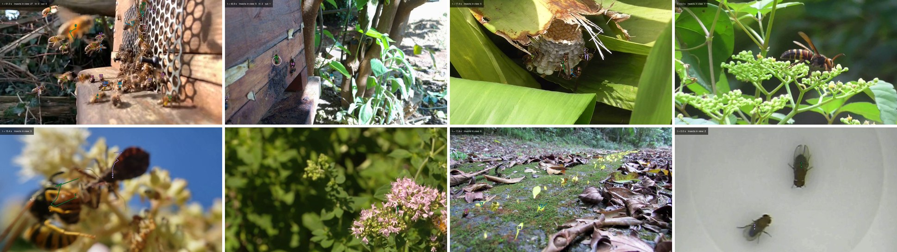
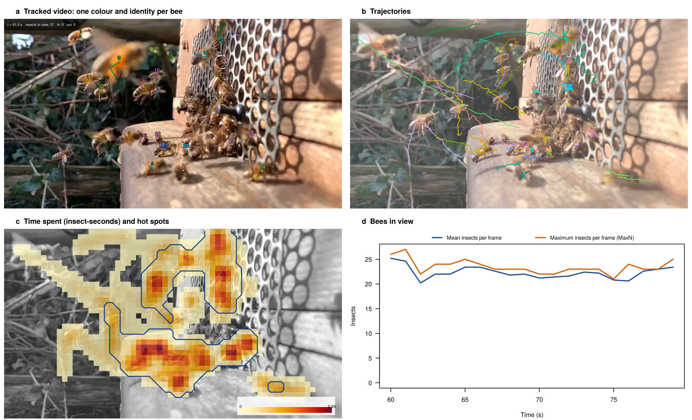

# InsectTrack

[](https://github.com/ehsanrahimi666/InsectTrack/actions/workflows/R-CMD-check.yaml)

**Detection, tracking and activity mapping of insects in videos**



`InsectTrack` turns videos of insects into tracks and activity measures in R.
It reads any video that FFmpeg reads, smartphone videos included, or a folder
of images. It finds the insects with a trained YOLO model, with an
open-vocabulary detector given a text prompt (Grounding DINO, OWLv2) or by
background subtraction, and follows each insect with one of twelve multi-object
trackers. One function writes an annotated video, in which every insect has its
own colour and identity number, together with tables, figures and a report:
activity over time, heat maps and hot spots of activity, visits to flowers or
other regions, insects entering and leaving nests and hives, crossings of
counting lines, proximity interactions and body size.

**Demonstration videos.** Twenty videos of honeybees, stingless bees,
bumblebees, leafcutter bees, paper wasps, hornets, yellowjackets, a butterfly,
a hoverfly, ants and fruit flies, analysed with the package, can be watched with
their tables and reports at
<https://ehsanrahimi666.github.io/InsectTrack-demos/>.

## Installation

```r
install.packages("remotes")
remotes::install_github("ehsanrahimi666/InsectTrack")
```

Background subtraction, the trackers implemented in R (Hungarian assignment,
SORT, ByteTrack), all summaries, figures, rendered videos and evaluation
metrics run in R alone. The deep-learning detectors (YOLO, Grounding DINO,
OWLv2, OWL-ViT), SAM 2.1 and the BoxMOT trackers need the optional Python back
end, installed once:

```r
library(InsectTrack)
it_install_backend()            # it_install_backend(gpu = TRUE) for an NVIDIA GPU
reticulate::use_virtualenv("insecttrack")
it_backend_status()             # module versions and the device used
```

## One call per video

```r
# a trained YOLO model, flower outlines as regions of interest
res <- it_track_video("PATH_TO_VIDEO.mp4", detector = "yolo", model = "PATH_TO_MODEL.pt",
                      rois = it_read_rois_json("PATH_TO_FLOWERS.json"), output_dir = "PATH_TO_OUTPUT_FOLDER")

# no trained model: Grounding DINO finds the insects from a text prompt, and the
# hive entrance is located from where tracks start and end
res <- it_track_video("PATH_TO_VIDEO.webm", detector = "gdino", prompt = c("bee", "honeybee"),
                      fps = 5, entrance = "auto", output_dir = "PATH_TO_OUTPUT_FOLDER")
res$entrance$counts             # insects in and out per time bin

# a laboratory arena with a plain background
res <- it_track_video("PATH_TO_VIDEO.avi", detector = "motion", fps = 25, interaction_dist = 60,
                      output_dir = "PATH_TO_OUTPUT_FOLDER")

# several videos with the same settings
it_track_videos(c("PATH_TO_VIDEO_1.mp4", "PATH_TO_VIDEO_2.mov"), output_dir = "PATH_TO_OUTPUT_FOLDER",
                detector = "gdino", prompt = "wasp")
```

## Quick start (runs as-is, no Python needed)

```r
library(InsectTrack)
v   <- it_example_video()                     # 10 s of honeybees on Delosperma flowers
det <- it_example_detections()                # YOLO26n detections of this video
tr  <- it_track(det, "bytetrack", track_thresh = 0.25, new_track_thresh = 0.3, frame_rate = 10)
fr  <- it_extract_frames(v, gray = FALSE)
bg  <- it_read_frame(fr$file[50], gray = FALSE)
it_plot_tracks(tr, 640, 360, background = bg)
it_track_summary(tr, width = 640, height = 360)  # duration, path length, speed per track
hm  <- it_hotspots(it_heatmap(tr, 640, 360, cell = 16, frames = fr, smooth = 1))
it_plot_heatmap(hm, background = bg)
it_render_video(fr, tr, "honeybees_tracked.mp4")
it_example_gallery()                          # tracked frames of other insects, with licences
```

## Outputs



Each call of `it_track_video()` writes to its output folder:

| File | Content |
|---|---|
| `<video>_tracked.mp4` | the video with a coloured trajectory and identity label per insect, running counts, entrance zone and regions |
| `tracks.csv`, `detections.csv` | every detection with its track, box, score and class |
| `track_summary.csv` | per track: duration, path length, speed, straightness, entry and exit edges, body size (SAM 2.1) |
| `activity.csv`, `activity.png` | insects per frame (mean and MaxN), tracks and new tracks per time bin |
| `heatmap.csv`, `heatmap.png`, `hotspots.png` | time spent per cell (insect-seconds) and Getis-Ord Gi* hot spots |
| `entrance_events.csv`, `entrance_counts.csv`, `entrance.png` | insects entering and leaving, per bin, with net flow |
| `visits.csv`, `visits_per_roi.csv` | visits to regions (number, duration, sequences between regions) |
| `line_crossings.csv`, `interactions.csv` | crossings of counting lines; proximity events between insects |
| `settings.json`, `report.html` | all settings, software versions and run times; summary page |

## Choosing a detector and a frame rate

- A YOLO model trained for the species and the camera set-up is the most
  accurate and fastest detector. A model trained on one insect and scene
  transfers poorly to others.
- Grounding DINO and OWLv2 need no training. They find large, isolated
  insects but miss small and crowded ones, and they take several seconds per
  frame without a GPU. Tiles (`detector_args = list(tile = 320)`) help with
  small insects. They are most useful to pre-label frames for training a YOLO
  model (`it_prelabel()`).
- Background subtraction (`detector = "motion"`) works with a fixed camera, a
  plain background and moving insects, as in laboratory arenas.
- Insects landing at a nest or hive entrance move fast. Record entrances at a
  high frame rate (for example 120 frames per second), so that the positions
  of an insect in consecutive frames are close and its track does not break
  before it enters.
- A track is the record of one insect while it stays in view: an insect that
  leaves and returns starts a new track, so tracks are not individuals.

## Functions

| Task | Functions |
|---|---|
| One call per video | `it_track_video()`, `it_track_videos()` |
| Frames | `it_video_info()`, `it_extract_frames()`, `it_frames_from_images()`, `it_check_stability()`, `it_read_frame()` |
| Detection | `it_detect_yolo()`, `it_detect_gdino()`, `it_detect_owl()`, `it_detect_motion()`, `it_read_detections()`, `it_read_yolo_labels()`, `it_merge_detections()` |
| Segmentation and annotation | `it_segment_sam2()` (body length, width and angle), `it_prelabel()` (YOLO and COCO labels for CVAT, Label Studio or Roboflow) |
| Tracking | `it_track()` with `"hungarian"`, `"sort"`, `"bytetrack"` (R) or the BoxMOT trackers `"ocsort"`, `"botsort"`, `"boosttrack"`, `"sfsort"`, `"hybridsort"`, `"occluboost"`, `"boxmot_bytetrack"`, `"strongsort"` and `"deepocsort"` (the last two with re-identification weights); `it_stitch()` joins fragments |
| Activity and space | `it_track_summary()`, `it_activity()`, `it_heatmap()`, `it_hotspots()` |
| Events | `it_roi_visits()`, `it_find_entrance()`, `it_entrance_counts()`, `it_zone_transitions()`, `it_line_crossings()`, `it_interactions()` |
| Plots and videos | `it_render_video()`, `it_plot_tracks()`, `it_plot_heatmap()`, `it_plot_activity()`, `it_plot_entrance()`, `it_track_colours()` |
| Evaluation | `it_eval_detections()` (precision, recall, F1), `it_eval_tracks()` (CLEAR MOT, IDF1), `it_eval_hota()`, `it_combine_hota()` (HOTA) |
| Back end and examples | `it_install_backend()`, `it_backend_status()`, `it_example_video()`, `it_example_detections()`, `it_example_gallery()` |

See `vignette("InsectTrack")` for a worked example.

## Limitations

- Accuracy is set mainly by the detector. Open-vocabulary detectors miss
  small insects and insects in crowds, and every detector misses insects that
  are hidden or blurred by fast flight.
- The package does not identify species beyond the classes of the detector.
- Identities are kept only while an insect stays in view, and they can switch
  when insects cross or cluster, for example at a hive entrance.
- Grounding DINO, OWLv2 and SAM 2.1 take several seconds per frame on a CPU;
  long videos need a GPU or a lower analysis frame rate.
- Hive entrances found automatically (`it_find_entrance()`) should be checked
  on a frame and drawn by hand when the densest cluster of track ends is not
  the entrance.
- The YOLO back end (ultralytics) and the BoxMOT trackers are licensed under
  AGPL-3.0.

## License

GPL (>= 3). The example video was recorded by the package authors. The gallery
images keep the licences of their source videos (CC0, public domain or CC BY);
see `it_example_gallery()` and `inst/extdata/gallery/ATTRIBUTION.csv`. The
README images are frames of videos by Midsummer Bees (CC BY 3.0), de Sá
Barbalho et al. (CC BY 4.0), The Nature Box (CC BY 4.0), Burroughs, Jackson and
Gillung (CC BY 4.0), the U.S. Department of Agriculture (public domain), Katja
Schulz (CC BY 2.0) and Cande et al. (CC BY 2.5).
